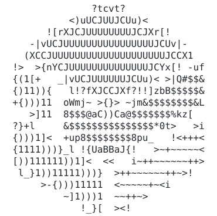

  <picture>
    <source media="(prefers-color-scheme: dark)" srcset="assets/logo-dark.svg">
    
  </picture>

<h3 align="center"><samp>joaquim manji-jung</samp></h3>

<samp>
i build ai tools for finance, and study how llm agents get numbers wrong. 
economics + computer science student in paris.
</samp>

<samp>
<a href="https://github.com/joaquimmj/deskstack/blob/main/bench/paper/deskstack-bench.pdf">paper</a> .
<a href="https://github.com/joaquimmj/deskstack">deskstack</a> .
<a href="https://github.com/joaquimmj/freeterminal">freeterminal</a> .
<a href="https://github.com/joaquimmj/cellrush">cellrush</a> .
<a href="https://github.com/joaquimmj/gapscout">gapscout</a> .
<a href="https://aptence.app">aptence</a> .
<a href="https://quantacademy.app">quantacademy</a> .
<a href="https://www.linkedin.com/in/joaquimmanjijung/">linkedin</a>
</samp>

 

<samp>

**research**

[filling the gaps](https://github.com/joaquimmj/deskstack/blob/main/bench/paper/deskstack-bench.pdf) — how often do llm agents misreport figures when they build financial models? 300 runs on 50 companies: 3.5% of filed figures wrong with web search alone, 0 of 3,230 with sourced filings data. hand-checked, pre-registered, [code and data](https://github.com/joaquimmj/deskstack/tree/main/bench).

**open source**

[deskstack](https://github.com/joaquimmj/deskstack) — your ai deal team inside claude. models built, tied out to the filings, reviewed. 
[freeterminal](https://github.com/joaquimmj/freeterminal) — free, citable us and european financial data for claude. paste one url. 
[cellrush](https://github.com/joaquimmj/cellrush) — monkeytype for spreadsheets. excel shortcuts, keyboard only. 
[gapscout](https://github.com/joaquimmj/gapscout) — find problems worth building, from real complaints and real search demand. 
contributor to [traceroot](https://github.com/traceroot-ai/traceroot) (yc s25, 1.4k stars) — llm cost tracking. 
contributor to [firecrawl](https://github.com/firecrawl/firecrawl) (yc s22, 200k stars) — crawler billing file links as pages. 
contributor to [univer](https://github.com/dream-num/univer) (24k stars) — formula engine crash and sort bugs, found by testing 500+ excel functions.

**building**

[aptence](https://aptence.app) — financial modeling assessments, graded automatically. 
[quantacademy](https://quantacademy.app) — finance interview prep. 5k users, built solo.

</samp>
