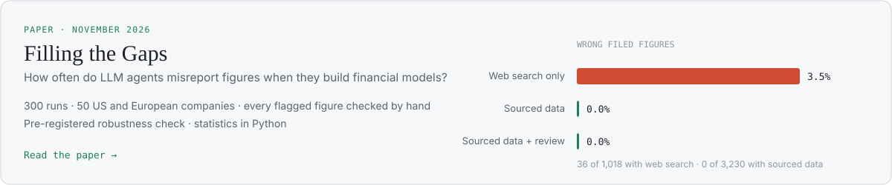
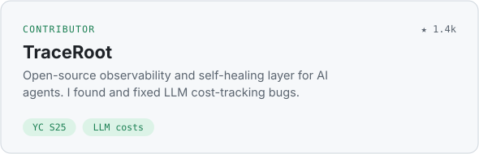
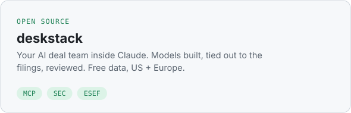
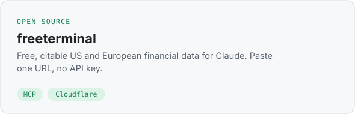
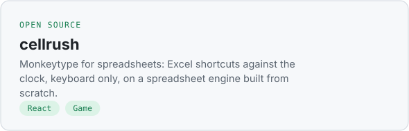
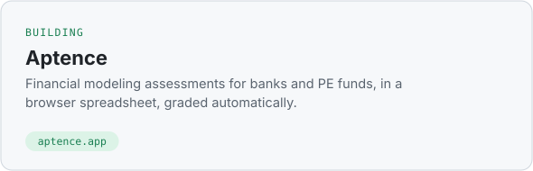
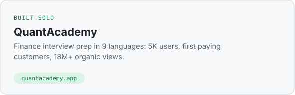

<a href="https://aptence.app">
  <picture>
    <source media="(prefers-color-scheme: dark)" srcset="assets/header-dark.svg">
    
  </picture>
</a>

 

<picture>
  <source media="(prefers-color-scheme: dark)" srcset="assets/section-research-dark.svg">
  
</picture>

<a href="https://github.com/joaquimmj/deskstack/blob/main/bench/paper/deskstack-bench.pdf">
  <picture>
    <source media="(prefers-color-scheme: dark)" srcset="assets/research-dark.svg">
    
  </picture>
</a>

  

<picture>
  <source media="(prefers-color-scheme: dark)" srcset="assets/section-open-source-dark.svg">
  
</picture>

  <a href="https://github.com/traceroot-ai/traceroot"><picture><source media="(prefers-color-scheme: dark)" srcset="assets/card-traceroot-dark.svg"></picture></a>
  <a href="https://github.com/joaquimmj/deskstack"><picture><source media="(prefers-color-scheme: dark)" srcset="assets/card-deskstack-dark.svg"></picture></a>

  <a href="https://github.com/joaquimmj/freeterminal"><picture><source media="(prefers-color-scheme: dark)" srcset="assets/card-freeterminal-dark.svg"></picture></a>
  <a href="https://github.com/joaquimmj/cellrush"><picture><source media="(prefers-color-scheme: dark)" srcset="assets/card-cellrush-dark.svg"></picture></a>

Also: <a href="https://github.com/joaquimmj/gapscout"><b>gapscout</b></a>, find problems worth building from real complaints and real search demand.

  

<picture>
  <source media="(prefers-color-scheme: dark)" srcset="assets/section-building-dark.svg">
  
</picture>

  <a href="https://aptence.app"><picture><source media="(prefers-color-scheme: dark)" srcset="assets/card-aptence-dark.svg"></picture></a>
  <a href="https://quantacademy.app"><picture><source media="(prefers-color-scheme: dark)" srcset="assets/card-quantacademy-dark.svg"></picture></a>

 

  <a href="https://www.linkedin.com/in/joaquimmanjijung/">LinkedIn</a>

